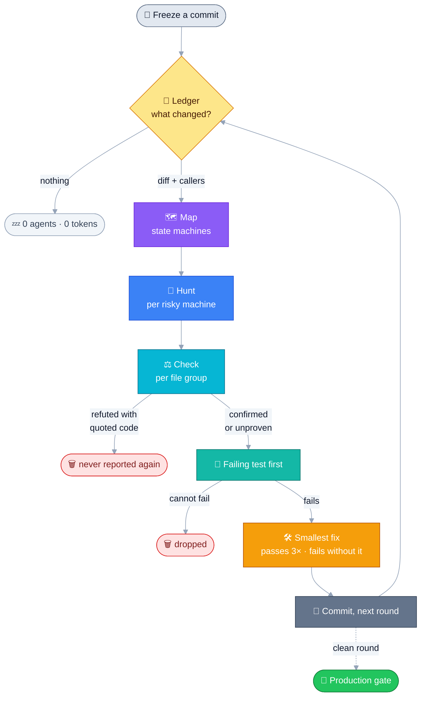

<div align="center">



<h3>The QA pipeline for Claude Code that hunts state bugs until zero,<br>and proves every one with a failing test.</h3>

[](https://github.com/ashusnapx/prodgate/actions/workflows/ci.yml)
[](https://skills.sh/ashusnapx/prodgate)
[](#-install)
[](#-benchmark)
[](#-why-prodgate)
[](#-standing-on-the-shoulders-of-caveman-and-ponytail)
[](LICENSE)

**[⚡ Install](#-install)** · **[🧩 How it works](#-how-it-works)** · **[📊 Benchmark](#-benchmark)** · **[🙏 Credits](#-standing-on-the-shoulders-of-caveman-and-ponytail)** · **[🔬 Research](docs/RESEARCH.md)**

</div>

---

Most AI code review reads a diff and gives an opinion. **prodgate runs a loop until the code is safe to ship.** It maps every implicit state machine in your app, hunts bugs on a frozen commit, dismisses a finding only by quoting the code that makes it impossible, proves the rest with a failing test, fixes them test-first, and repeats until a round finds nothing. Then a production gate runs.

It is built for the bugs that pass review and code coverage and still break production: 🔀 two requests interleaving · 💥 a job that crashes halfway · 📨 a webhook delivered twice · 🗂️ a tab left open on an old version · 🔁 a screen that never stops polling · 🏢 one tenant reading another's data.

## 🎬 What a run looks like

```diff
@@ ◆ prodgate · round 1 · shop-api@1a2b3c4 @@
  🗺️  23 state machines mapped · 🔴 9 high risk · 🟡 10 medium · 🟢 4 low
  🔎 41 reported · ✨ 41 new
- ⚖️  ❌ 12 refuted with quoted code (e.g. orders.py:88 checks rowcount)
+ ⚖️  ✅ 22 confirmed · 🟡 7 unproven, sent to a test
+ 🛠️  ✅ 27 fixed with full evidence · 🚫 2 not reproduced, left alone
@@ ◆ prodgate · round 2 · scope: 14 changed files + 9 callers · ♻️ 312 files skipped @@
+ 🛠️  ✅ 6 fixed
@@ ◆ prodgate · round 3 · scope: 4 changed files @@
+ 🟢 clean round
@@ 🚦 production gate @@
+ ✅ suites  ✅ types  ✅ lint  ✅ build  ✅ review  ✅ security  ✅ secrets  ✅ migrations
+ 🚀 prodgate: ready to ship
```
<sub>Illustrative run on an imaginary repo, to show the shape. Measured numbers are in the <a href="#-benchmark">benchmark</a>.</sub>

## ✨ Why prodgate

| | 🤖 Typical AI review | 🛡️ prodgate |
|---|---|---|
| **What it reads** | ❌ The diff alone, or the whole repo every time | ✅ What changed since the last check, never-reviewed files and their callers. **Unchanged code costs 0 tokens** |
| **When a finding counts** | ❌ When the model sounds sure | ✅ When a test fails because of it |
| **How a finding is dismissed** | ❌ The model is unsure | ✅ Only by quoting the guard, lock or check that makes it impossible |
| **When a fix counts** | ❌ The tests pass | ✅ Its test failed before, passes 3×, and fails again with only the fix undone |
| **When it stops** | ❌ After one pass | ✅ A clean round on a frozen commit, then a production gate |
| **Repeats** | ❌ The same issues every run | ✅ Every finding is keyed and never argued about twice |

## 🧠 The prompt at the heart of it

```text
Find all of the implicit state machines in my app.
```

Status columns, boolean flags, nullable timestamps, job queues, sessions, wizard steps, polling loops and cached screens are all state machines that nobody drew. Most production bugs live in the moves between their states. prodgate turns that one prompt into a pipeline.

## 🧩 How it works



| Stage | What happens |
|---|---|
| 🗺️ **Map** | Every implicit state machine, with states, transitions, guards, actors and a 🔴 🟡 🟢 risk level |
| 🔎 **Hunt** | Races, stuck states, stale overwrites, illegal transitions, tenant leaks, double submits, lost UI state |
| ⚖️ **Check** | One checker per file group. "Refuted" needs a quoted line; anything unsure goes to a test |
| 🧪 **Prove** | A failing test, with a hook between the read and the write for races (never sleeps) |
| 🛠️ **Fix** | The smallest change, accepted only with evidence. One owner per file, so fixes never collide |
| 🚀 **Gate** | Suites, types, lint, build, fresh-eyes review, security, secrets, migrations, a browser smoke test |

More in [how it works](docs/HOW-IT-WORKS.md).

## ⚡ Install

**1️⃣ Install prodgate**, in one line:

```bash
npx skills add ashusnapx/prodgate
```

<details>
<summary>Or as a Claude Code plugin</summary>

```text
/plugin marketplace add ashusnapx/prodgate
/plugin install prodgate@prodgate
```
</details>

**2️⃣ Install the two plugins prodgate requires.** Every agent prodgate runs uses both at their maximum setting, and prodgate will not start without them:

```bash
claude plugin marketplace add JuliusBrussee/caveman && claude plugin install caveman@caveman
claude plugin marketplace add DietrichGebert/ponytail && claude plugin install ponytail@ponytail
```

**3️⃣ Run it.** In any repo, say `/prodgate`, *"run QA"*, *"set up a QA pipeline"*, *"make it prod ready"* or *"bug hunt until zero"*.

It works on any language Claude Code can read. The gate gets sharper with the code-review-graph MCP (blast radius), `gitleaks`, `npm audit` and `pip-audit`.

## 💸 Built to waste nothing

Most of an agent run's cost is the input it reads, re-sent on every turn. prodgate cuts input first:

| | Saving | How |
|---|---|---|
| 📒 | **Ledger of coverage** | Each file is recorded with the commit it was checked at. A round reads only the diff, never-reviewed files and their callers |
| 📌 | **Frozen commits** | Nobody hunts code that is still changing, so no finding goes stale before it is read |
| 🧺 | **Batched checks** | One checker per file group settles all of that group's findings: each file is read once |
| 🤐 | **Compact test output** | One line on a pass, only the failing lines on a fail |
| 🪨 | **caveman + ponytail at ultra** | Required in every agent: terse output, the smallest complete change |
| 🎚️ | **Risk tiers** | Low-risk machines are packed together and can run on a lighter model |

## 📊 Benchmark

[`bench/`](bench/) is a public benchmark for state-bug finders: **8 realistic apps** (FastAPI + SQLAlchemy, plus TypeScript UI state), with **59 seeded bugs** across 8 bug classes and **24 decoys**, code that looks wrong but is correct. Every seeded bug was confirmed with a failing test, every decoy with a passing one, and every app's own test suite passes with the bugs in place.

| Mode | What runs |
|---|---|
| 🤖 `oneshot` | A plain "review this codebase for bugs" agent per app |
| 🧠 `prompt` | The state-machine prompt alone: one pass, nothing checked |
| 🛡️ `prodgate` | The full pipeline, report-only |
| 🔁 **re-check** | A small change lands in two apps, and each approach checks again |

> 📈 **Results:** the first full run is being scored. Recall, precision, decoy hits and tokens measured from the agents' own usage logs will be published here. They will not be estimates.

## 🙏 Standing on the shoulders of caveman and ponytail

prodgate's token discipline comes from two open-source projects. Every agent prodgate starts loads both at `ultra`, with no opt-out.

<table>
<tr>
<td width="50%" align="center" valign="top">
<a href="https://github.com/JuliusBrussee/caveman"></a>
<br><br>
<b><a href="https://github.com/JuliusBrussee/caveman">caveman</a></b> by <a href="https://github.com/JuliusBrussee">Julius Brussee</a>
<br><br>
Makes agents say less and read less. prodgate uses <code>ultra</code>, the strongest measured voice: <b>35% fewer output tokens than "be concise"</b>, by caveman's own measurement. When the caveman CLI is installed, prodgate's test runner also uses <code>caveman shrink</code>.
</td>
<td width="50%" align="center" valign="top">
<a href="https://github.com/DietrichGebert/ponytail"><picture><source media="(prefers-color-scheme: dark)" srcset="https://raw.githubusercontent.com/DietrichGebert/ponytail/main/assets/logo-dark.png"></picture></a>
<br><br>
<b><a href="https://github.com/DietrichGebert/ponytail">ponytail</a></b> by <a href="https://github.com/DietrichGebert">Dietrich Gebert</a>
<br><br>
Makes agents write the smallest complete change. prodgate uses <code>ultra</code>, so fixers question the request first. By ponytail's own benchmark: <b>45% fewer tokens and 53% less code</b>, with 98% of risky logic shipping with a test.
</td>
</tr>
</table>

<sub>Logos belong to their projects and are shown here only to credit them. prodgate works with caveman and ponytail; it is not affiliated with or endorsed by either. caveman is Apache-2.0, ponytail is MIT.</sub>

## 🔬 Research

prodgate's rules come from how Google, Meta, Amazon, Microsoft, the AIxCC winners, Jepsen and FoundationDB decide what counts as a bug. The short version: **executable proof, not LLM opinion, decides**. Read [the evidence and what was taken from it](docs/RESEARCH.md).

## 🗂️ Repo layout

```text
skills/prodgate/     the skill: SKILL.md, prodgate.workflow.js, bin/ (ledger, qa-run, require-plugins)
bench/               fixtures, answer keys, scorer, token counter, benchmark workflow
docs/                how it works, research
tests/               workflow control flow (fake agents), ledger and scorer tests
cli/                 the npm installer
```

## 🤝 Contributing

New fixture apps with seeded state bugs are the most useful contribution: see [bench/SPEC.md](bench/SPEC.md). Bug reports that come with a failing test are welcome too.

<div align="center">

---

**⭐ If prodgate catches a bug before your users do, a star helps others find it.**

MIT © ashusnapx

</div>
