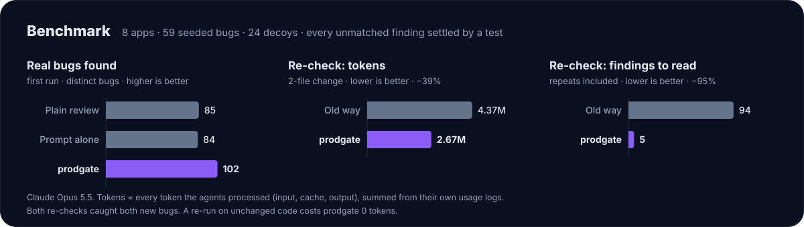

# Benchmark results

Run on 17 Nov 2026 with Claude Opus 5.5 (judges: Claude Sonnet 5.5). One run per mode. Raw findings, judge verdicts and token counts are in [`results/`](results/); the chart is drawn from them by [`scripts/chart.py`](scripts/chart.py).

## First run: 8 apps, 59 seeded bugs, 24 decoys

| | 🤖 Plain review | 🧠 Prompt alone | 🛡️ prodgate v1 |
|---|---|---|---|
| Seeded bugs found | 52/59 (88%) | **56/59 (95%)** | 54/59 (92%) |
| Real bugs found, distinct (seeded + proven unseeded) | 85 | 84 | **102** |
| Precision (unique reports that are real) | **98.9%** | **98.9%** | 92.5% |
| Reports | 89 | 91 | 190 |
| Duplicate reports | 1 | 1 | 44 |
| Decoy hits | 1 | 0 | 2 |
| Each report ships with a failing test | no | no | **yes** (190 of 190; independent tests rejected 13 of them, about 7%) |
| Agents | 8 | 8 | 62 |
| Tokens processed | **3.35M** | 3.87M | 35.0M |
| Tokens written | **68k** | 84k | 558k |
| Wall time | **3.4 min** | 4.2 min | 19.8 min |

Seeded bugs found, by class:

| Class | Plain review | Prompt alone | prodgate v1 |
|---|---|---|---|
| race | 4/6 | 6/6 | 6/6 |
| stuck | 9/11 | 10/11 | 10/11 |
| illegal-transition | 10/11 | 10/11 | 9/11 |
| double-submit | 6/7 | 6/7 | 7/7 |
| overwrite | 5/6 | 6/6 | 6/6 |
| scope | 6/6 | 6/6 | 5/6 |
| wrong-item | 6/6 | 6/6 | 5/6 |
| ui-unhandled | 6/6 | 6/6 | 6/6 |

## Re-check: a 2-file change lands in 2 of the 8 apps

Each change turns correct code into a new bug: a batch close loses its compare-and-swap, and a poller's `stop()` stops invalidating in-flight responses.

| | 🔁 Old way (the prompt over all 8 apps again) | 🛡️ prodgate v1 | 🛡️ prodgate v1.1 |
|---|---|---|---|
| New bugs caught | 2/2 | 2/2 | 2/2 |
| Findings to read | 94 (92 already known) | 6 | **5 (−95%)** |
| Agents | 8 | 7 | **6** |
| Tokens processed | 4.37M | 3.45M (−21%) | **2.67M (−39%)** |
| Tokens written | 85.6k | 37.6k (−56%) | **28.4k (−67%)** |
| Wall time | 5.5 min | 3.9 min | **3.8 min** |
| Re-run on unchanged code | 4.37M again | 0 | **0** |

v1.1 is v1 with two fixes this benchmark exposed: a small diff gets one hunter instead of the maximum, and near-duplicate findings are merged before anything is proven.

## How it was scored

1. **Matching.** A finding is a candidate match for a seeded bug when it is in the same file and within 10 lines of the bug's span (or names the same function). A Sonnet judge then checks every candidate pair for the same mechanism, strictly. 219 of 402 pairs passed.
2. **Everything else gets a test.** Every finding that matched no seeded bug, 162 in all, went to an independent Sonnet tester. A finding counts as a real bug only if the tester wrote a test that fails because of it. 149 were real.
3. **Decoys.** A finding on a decoy's lines that no test proved real counts as a decoy hit. Most findings on decoy lines turned out to be different, real bugs on the same lines.
4. **Tokens** are every token the agents processed (fresh input, cache writes, cache reads and output), summed from each agent's own usage log by [`tokens.py`](tokens.py), with each message counted once. All modes ran in the same environment with the same global settings.

## What this does and does not show

- **prodgate's first run is expensive**: about 10× the tokens of a plain review, because every finding is proven and the v1 hunters overlapped. Its payoff is 20% more real bugs, each with a test. Choose a plain review if you need a quick first look.
- **The prompt alone is strong.** On seeded bugs, one pass of "Find all of the implicit state machines in my app" beat a plain review (95% against 88%) at about the same cost.
- **Re-checks are where prodgate is cheaper,** and the saving grows with the repo. Here the change touched 2 of 8 small apps, so prodgate still read about a quarter of the code. In a large repo, a small change is a far smaller share. That is a projection, not a measurement.
- **Limits:** one run per mode (no variance measured); small apps of 600 to 900 lines; fixtures and hunters are both Claude models; each fixture's README states the rules its bugs break, which helps every mode equally; LLM judges can err, so their verdicts are published for review.
