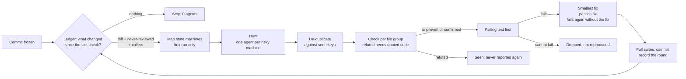

# How prodgate works

## The parts

| Part | What it does | Why |
|---|---|---|
| **Freeze** | Hunters read one committed SHA; nobody edits during a hunt | Findings on code that is still changing are stale before anyone reads them |
| **Ledger** (`bin/ledger.py`) | Records each file and the SHA it was checked at, plus the state-machine map, seen findings, per-machine streaks and per-kind noise | Unchanged code is never re-read. A re-run on unchanged code costs nothing |
| **Map** | Lists every implicit state machine: status columns, flags, nullable timestamps, jobs, sessions, UI modes, polling loops. Each gets states, transitions, guards, actors and a risk level | Bugs live in the moves between states; the map tells hunters where to look |
| **Hunt** | The state-machine prompt, limited to the scope and the machines it touches. High-risk machines get their own hunter | Focused hunters find more and read less |
| **Check** | One agent per group of files checks all of that group's findings. "Refuted" needs a quoted guard, lock or check. Anything unsure becomes "unproven" | LLM refuters delete real bugs when unsure; tests are a better judge |
| **Prove / fix** | Every live finding gets a failing test. Report-only runs write it in a scratch folder; fix runs write it in the repo, fix the code, run it 3 times, then undo only the fix and see it fail | A bug without a failing test is an opinion. A fix whose test passes without it proves nothing |
| **Design** | A machine with bugs in 3 rounds in a row gets a critic and a simplicity reviewer before more patches | Patching the same machine forever is a design smell |
| **Noise budget** | A kind of finding that is refuted or unreproduced more than half the time (after 4) must come with a line-by-line repro | Noisy checks waste tokens and trust |
| **Gate** | Suites, typecheck, lint and build; fresh-eyes review; security, secrets, dependencies, migrations, a contract check; a smoke test in a browser | A clean round is not the same as ready for production |

## Where the tokens go, and how prodgate saves them

Most of an agent run's cost is the input it reads, re-sent on every turn, not the words it writes. So prodgate's biggest savings come from reading less:

1. **Scope.** After the first run, a round reads only the diff, never-reviewed files and their callers. Unchanged code costs 0.
2. **Batching.** Checkers and provers work per group of files, so a file is read once for all of its findings, not once per finding.
3. **Seen keys.** A finding that was refuted or fixed is never reported, checked or argued about again.
4. **Compact test output.** `qa-run` prints one line on a pass and only the failing lines on a fail. Fixers run each test 5 or more times, so this adds up. With the caveman CLI installed, it uses `caveman shrink`.
5. **Lean agents.** Every agent reads by line range after `grep -n`, never reads a file twice, and answers with a schema. Every agent is required to run the [caveman](https://github.com/JuliusBrussee/caveman) and [ponytail](https://github.com/DietrichGebert/ponytail) plugins at `ultra`: caveman's strongest measured voice, and ponytail's smallest-change rules. prodgate checks for both before it starts (`bin/require-plugins`) and puts the requirement at the top of every agent's prompt.
6. **Risk tiers.** Low-risk machines can run on a lighter model (`models.light`).
